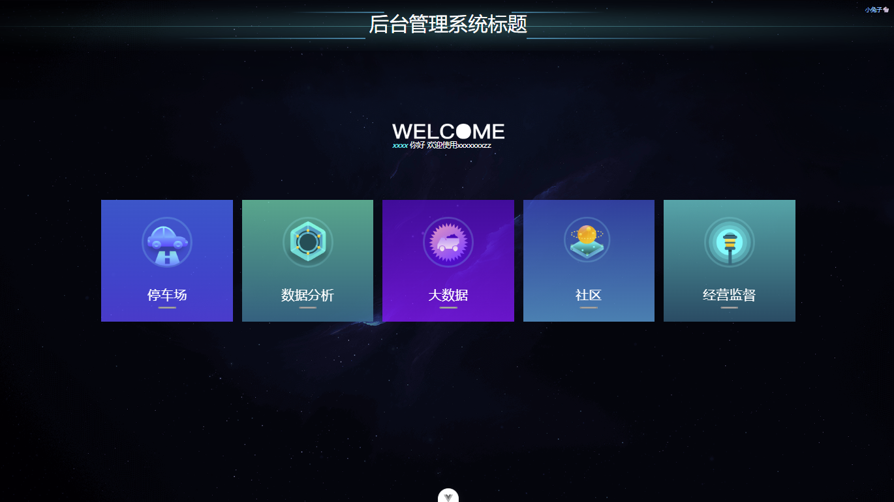
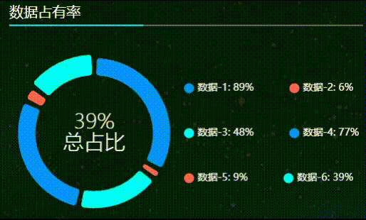
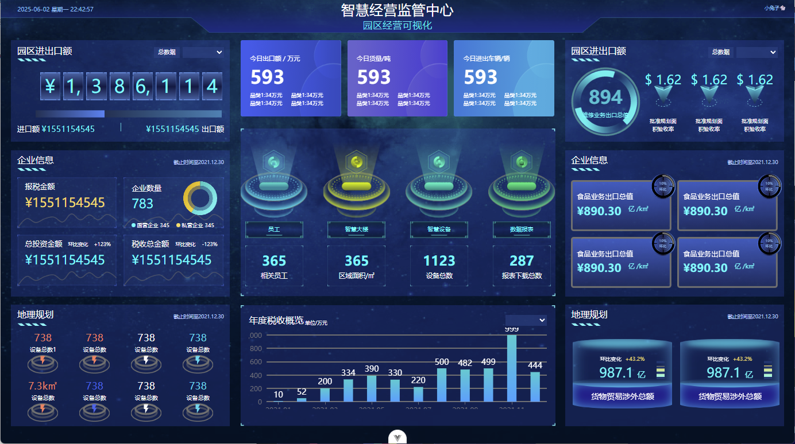
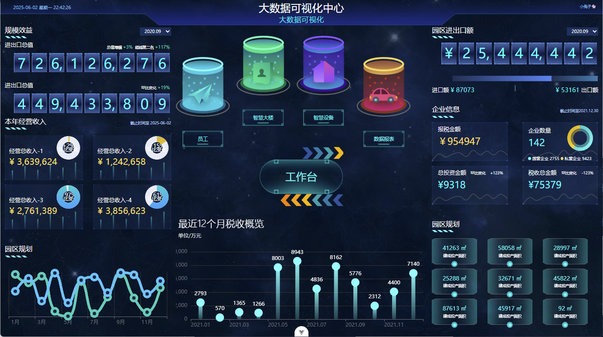
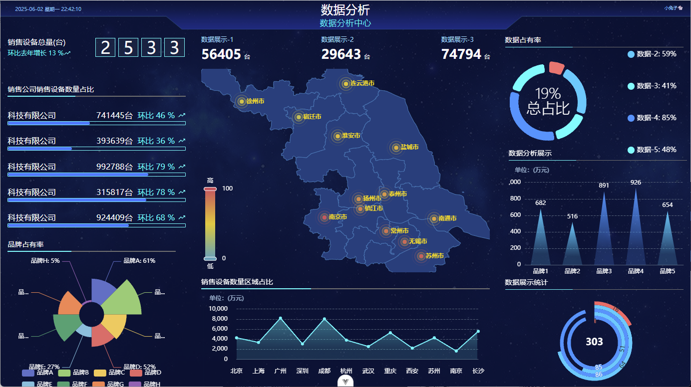
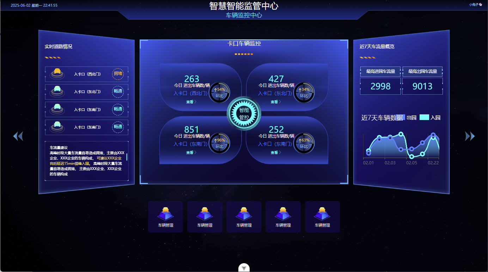

# kanban-screen

Vue 3 数据可视化大屏样例。停车、社区、经营监管等几套主题屏，数据走 Mock，没有接真实后端。

设计稿买自闲鱼，标题和结构改过一些。早期按 `xxx-left` / `xxx-right` 硬拆页面，后来按业务域重做了一版（布局壳、`--kanban-*` 变量、HTTP/Mock 契约），本仓库是重构后的版本。

## 快速开始

需要 Node `^18.18 || ^20.9 || >=21.1`，包管理器用 **pnpm 11+**。

```bash
pnpm i
pnpm dev
```

```bash
pnpm build
pnpm preview
```

## 包含

| 路由 | 内容 |
| --- | --- |
| `/portal` | 入口 |
| `/parking` | 智慧停车 |
| `/community` | 社区 |
| `/analyse` | 数据分析 |
| `/business` | 经营监管 |
| `/insight` | 大数据 |
| `/login` | 登录页 UI（演示用，逻辑很薄） |

- 适配用 **autofit**，按 `1920×1080` 设计稿等比缩放。
- 接口用 `vite-plugin-fake-server` 模拟，路径前缀见 `.env` 里的 `VITE_MOCK_BASE_API`（默认 `/mock`），类型和 `src/api` 对齐。
- 图表是 ECharts；部分屏有轮询刷新、饼图自动高亮一类交互。

## 技术栈

Vue 3 · Vite · TypeScript · Pinia · UnoCSS · Sass · ECharts · autofit.js · axios

## 预览

| 入口 | 数据分析 |
| --- | --- |
|  |  |









## License

[Apache-2.0](./LICENSE)
